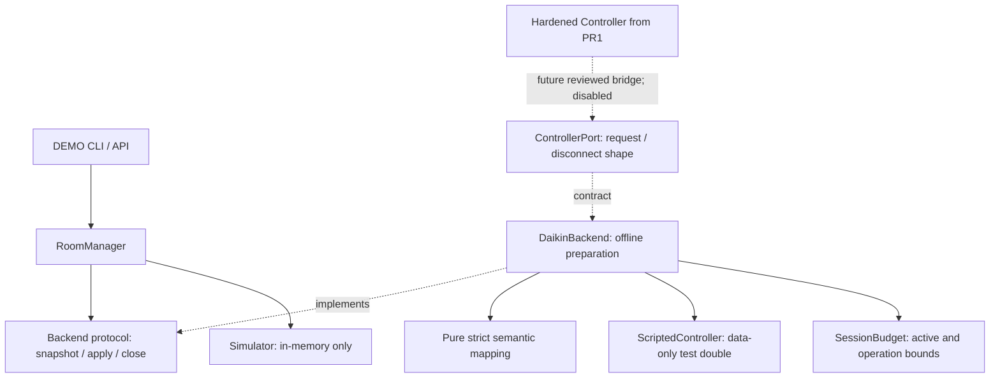

# Iteration 3 — offline Daikin adapter preparation

## Status and dependency boundary

Branch `feature/ble-adapter-offline`, independently based on PR #2 `92f715a469806ea61da6c87e260d7e6ed4488f25`. This is **adapter preparation tested with doubles**, not an operational physical backend. `multiroom_app.py --real` still rejects before DB/backend creation; legacy CLIs, write helpers and automatic services remain blocked. No driver import, address lookup, scan, connection, pairing, real write, installer setting, native lock or reconnection is added. Mac B NOT MODIFIED; HARDWARE_BLE NOT_TESTED; ENFORCE_PHYSICAL DISABLED; PRODUCTION_CHANGED NO.



No CLI/API/configuration edge reaches DaikinBackend. It accepts **only exact type ScriptedController**, not arbitrary ports/subclasses, callable factories or the legacy Controller. `from_physical_controller` unconditionally raises PhysicalBackendDisabled. The Protocol documents the future request boundary without importing `daikin_server`/Bleak or granting activation. A future real bridge needs a separately reviewed code/guard change and explicit physical authorization. It is not enabled by passing a flag or real address.

## Interface and simulator

`backends/base.py` defines Backend with `info`, `async snapshot(fields)->dict`, `async apply(action,value)->None`, `async close()->None`. BackendUnavailable represents an untrustworthy observation/effect. Simulator is moved intact into its own module and re-exported from manager for compatibility. Manager still constructs Simulator exclusively and retains its exact-type automatic-correction guard. No automatic corrections can reach this adapter. Simulator has no adapter, controller or Bleak dependency.

Room.backend is typed to the Protocol. Manager target checks use latest reported limits, or the same conservative 16–32°C simulator fallback before an initial read, instead of accessing backend.state directly. Laboratory state mutation remains explicitly simulator-specific. Factory injection or live-adapter wiring into RoomManager is intentionally absent. Existing locks, failure state, policies, DB and API validation remain intact.

## Controller bridge shape and mapping

The future ControllerPort matches hardened PR 1 `request(cmd_id,args=None,timeout=6.0)->dict[int,bytes]` and `disconnect()`. Adapter never calls legacy `get_status`/`refresh`: those can hide absent values with defaults or capture errors as a dictionary. It uses raw request-object dictionaries and independent strict validation. Unknown BLE commands are not invented; existing power/mode/fan/setpoint command IDs/builders are retained.

| Requested group | Required evidence |
| --- | --- |
| power | GET_POWER object 0x20, exactly one byte, 0 or1 |
| mode | GET_MODE object 0x20, exactly one byte, 0–5 |
| fan | Mode dependency plus active cooling 0x20/heating 0x21, one byte, 1–5 |
| setpoint | Mode dependency; cooling 0x20 and heating 0x21, two bytes each; active lower/upper limits 0xA2/ 0xB2 or0xA3/ 0xB3, two bytes; 10–40°C sanity and consistent active window |
| sensor | Explicit object 0x40, signed one byte,−40–80°C; explicit zero-length means unsupported, returned as None with field_status=unsupported |

Missing required object/response, incorrect width/type, unsupported control value, invalid enumeration, zero/unverified range or inconsistent limits raises InvalidSnapshot and stops the adapter. Missing sensor data is an error, distinct from explicitly unsupported optional room temperature. Returned field_status describes available/unsupported values; no default power, mode, fan or limits is fabricated. Unrequested groups are not required. Byte widths, ranges and field meanings are offline schema assumptions pending real captures; rejecting unknown firmware data is deliberate, not proof of universal compatibility.

Setpoints decode exact fixed-point raw/ 128; display rounding is never used to confirm an effect. A readback of23.875 cannot confirm 24.0. Both cooling/heating values must confirm a target because the retained write sets both equally. Setpoint writes first read the reported window, validate the requested 16–32°C target within it, and retain integer rounding plus the existing full range/limit field block. This does not validate zeroed limit semantics on physical hardware.

## Coordination, STOP and cleanup

Per-adapter lock covers an entire snapshot or explicit command with pre-read/readback. Concurrent same-adapter calls reject as busy rather than forming an unlimited queue. SessionBudget separately limits retained sessions (default 1, configurable 1–6) and concurrent operations (default 1, 1–6). Use one shared budget per coordinator; it detects duplicate ownership inside that budget. These counters do not certify six native connections. There is no reconnection/retry policy.

Operation deadline includes semaphore wait and all exchanges. Errors, malformed replies, timeouts and cancellation latch STOP, clear latest and prevent subsequent requests until a deliberately new reviewed session. Invalid local inputs fail before admission and do not poison an existing session. A session waiting for capacity cannot later write after its deadline. Exchange guards run before **and after** every request: close during a multi-command pre-read prevents later commands/writes. An ACK is not proof of application: apply returns only after matching readback; mismatch raises WriteNotConfirmed and STOP. Observations are not an atomic physical snapshot across wire commands; other controllers can change the system between reads.

Close marks closed/STOP before waiting for the lock. Only an admitted owner calls disconnect; rejected/unadmitted adapters cannot disconnect another owner's double. Successful close is idempotent and releases its reservation. The data-only double's disconnect is bounded and cooperative; native cleanup, cancellation resistance and ownership on uncertain disconnect must be re-evaluated before any physical implementation. No in-memory adapter STOP replaces persistent policy STOP in RoomManager; real coordinator integration is future work.

## Double and test evidence

ScriptedController accepts per-command lists of Reply(data/error/delay), records calls and returns copies. It has no I/O callbacks, driver factory or address; writes do not automatically mutate observations, so readback must be separately planned. Snapshot copies are isolated.

Python 3.12 and 3.14 final suites (each): **270 PASS, 0 FAIL, 1 existing Starlette warning** (227 base tests intact plus 43 adapter regressions). Tests cover all modes and active branches, missing/unsupported/invalid fields and widths, exact readback, all four writes/full setpoint payload, ACK without effect, six sessions with two operation slots and one fault, duplicate ownership, no-owner close, session capacity, busy, capacity deadline, cancellation, close during pre-read, input rejection, idempotent cleanup and import guards. A subprocess forbids both Bleak and legacy module imports while exercising adapter import and the complete DEMO app. Physical factory/arbitrary object construction is rejected before inspecting the supplied object.

Independent review reproduced three P2 defects: exchanges continuing after close, rounded false readback confirmation and no-owner disconnect. All three were corrected with specific regressions; independent code revalidation 270 PASS/ 0 FAIL/ 1 warning. Final independent code and documentation review: PASS. Both offline CLI selftests also passed. The unchanged base Chromium harness validates that extracting Simulator preserves the existing UI/API flow; no new physical browser/backend mode is exposed.

## Offline Mac B handoff

Not executed on Mac B. Use a fresh separate checkout/venv and compare exact PR SHA:

```bash
git clone --branch feature/ble-adapter-offline --single-branch https://github.com/javigines/Daikin-BRC1H-Mac-Web-Control.git Daikin-Adapter-Offline
cd Daikin-Adapter-Offline
git rev-parse HEAD
python3.12 -m venv .venv-offline
.venv-offline/bin/python -m pip install -r requirements-dev.txt
.venv-offline/bin/python -m pytest -q
.venv-offline/bin/python daikin_server.py --selftest
.venv-offline/bin/python brc1h_spike.py --selftest
```

Optional unchanged DEMO: `.venv-offline/bin/python multiroom_app.py --demo --db demo_history.db --port 8000`. Never use the operational DB/venv or real inventory. No SSH, configuration/permissions changes or services. **STOP here.** CLI real and physical creation must stay rejected; do not bypass guards to validate the adapter.

## Gates for a first future physical test

1. Separate owner authorization identifying one UUID/model/firmware, operator physically present, test window, STOP and restoration plan; private room↔controller identity verification. No automatic six-controller startup.
2. Reviewed enabling change, authenticated/authorized owner controls, single-budget ownership including other local clients, one active connection and one operation initially. Resolve native Connecting cancellation/partial disconnect risk; public completion is not proof of native release. No private API workaround or reconnect loop.
3. Read-only one-controller setup/query/cleanup, raw captures confirming exact fields/widths/mode selection/ranges/unsupported states. Verify local screen responsiveness after exit. Unexpected prompt, timeout, link/read/cleanup fault or changed physical behavior means STOP, no automatic retry/unpair/power cycle.
4. Separate manual-write approval, safe values and restoration; confirm ACK versus readback and physical screen, exact temperatures, equal/independent setpoints, zeroed limits and fan semantics. Treat external updates/origin as unknown.
5. Review close/cancel/sleep/restart/native cleanup evidence before increasing capacity. Production persistence, auth, quota/backup and diagnostics remain gates. Physical ENFORCE and auto-on stay disabled until further explicit authorization/safety review; native locks require an official separate Madoka Assistant procedure.

The existing [BLE audit](ble-reliability-audit.md) and [policy gates](control-policies.md) remain binding limitations. No hardware evidence is created by these doubles.
