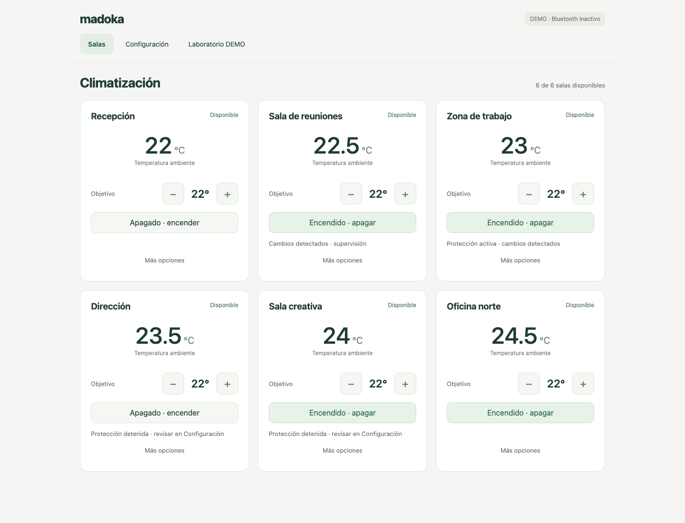
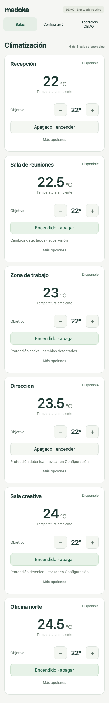
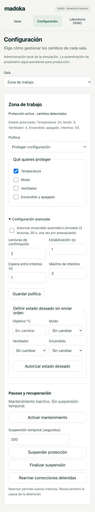

# Iteration 3 — routine controls separated from administration

Integration note: the sibling PR history and original validation below are preserved. The current combined tree and acceptance evidence are documented in [Iteration 3 integration](iteration-3-integration.md). No target branch or existing PR was merged by this integration work.

## Identity and scope

Branch `feature/ux-simplification`, independently based on PR #2 commit `92f715a469806ea61da6c87e260d7e6ed4488f25`. No backend, API, storage, policy or dependency behavior is changed. No BLE, SSH, Mac B, services, merges or deployments. The sibling documentation PR normalizes inherited documentation; this new report, comments and PR description are English, while product text remains Spanish.

## Interaction changes

The main page contains six compact room cards with name, availability, ambient temperature, target, immediate −/+ controls, power, an optional plain-language protection notice and “Más opciones”. IDs, firmware, mode/fan forms, history, policy forms and laboratories are absent from cards. Removed decorative introduction, duplicate notices and future-feature promotion. Availability and protection use words in addition to color. Touch targets are at least 44 px; skip link, visible focus, semantic labels and native dialogs support keyboard use.

Room detail exposes mode, fan, power, target, timestamp, errors/availability and history. “Configuración” selects a room and maps FREE/MONITOR/ENFORCE to “Libre”, “Supervisar cambios”, “Proteger configuración”. Protected fields and authorized desired-state patches remain available; confirmations, stabilization, cooldown, budgets and auto-on consent are under advanced configuration. Auto-on is still off by default. Maintenance, suspension/resumption and reset are separate actions requiring confirmation and a reason. Cancelling confirmation makes no request. Restriction payloads are built from a fresh room GET when confirming, preserving the other current restriction and recomputing remaining suspension time. Integer-second API precision may round its deadline up by less than one second; this is not an optimistic-concurrency revision protocol. A concurrent writer after the GET still requires server-side versioning in a future auth/admin iteration.

“Laboratorio DEMO” exclusively holds failure/disconnection/delay/recovery, simulated external changes, technical events and model/ID diagnostics. It is explicitly simulator-only, not a hardware tool. Native lock status remains not applied/not verified. Hiding administration is not authorization: existing backend validation/token/Origin/Host rules are unchanged, and production owner authentication remains mandatory.

## Preserved behavior checklist

| Capability | Preserved access/evidence |
| --- | --- |
| Six independent rooms; four ordinary controls | Card target/power; detail mode/fan; six-room E2E verifies state independently |
| Read-only status and per-room history | Card/detail and history dialog with actual read timestamps |
| Stale/error/timeout/busy handling | Per-room disabled controls, actual response rendering; no optimistic applied state |
| Request isolation and ordering | Captured room objects, per-room busy/epoch; older GET cannot overwrite a mutation |
| Local token refresh/security | Same-origin JSON/token API unchanged; server-restart token E2E retained; no write replay |
| Desired/observed persistence and all three policies | Unmodified backend; dedicated configuration forms |
| Protected fields/advanced budgets/auto-on | Independent field checkboxes; advanced parameters; default guard retained |
| Maintenance/suspension/STOP/reset | Separate confirmed actions, required reason, persistent backend audit |
| Lab failures/external changes/recovery/events | Dedicated laboratory, unchanged per-room endpoints |
| Migration/configuration/resource bounds | Backend unchanged; full 227-test suite retained |

## Diff audit and independent review

Changed frontend assets, browser harness and this report/screenshots only. Review found P2: confirmation captured an old suspension duration and could extend or overwrite an independent restriction; fixed by fresh status/body construction at submit, with delayed-confirmation/remote-change E2E. Review found P3: visiting admin/lab before initial room data left an empty panel; fixed by hydrating the active view as data arrives, with both startup paths tested. History/event dialog epochs also reject stale results after closing. CSS review aligned detail buttons and removed empty status space without hiding errors.

No unsafe HTML rendering was introduced: names, statuses, errors and event JSON use textContent. Tests retain hostile name/error rendering, stale 5s, fault isolation, token restart, histories and three policies. Forms reset when switching selected room, so unsaved values cannot silently target another room. The backend remains the authority. Final independent review: PASS for the diff and fixes, with an independent Python 3.12 run of 227 PASS / 0 FAIL / 1 warning. Chromium execution is the implementation validation described below, not an additional independent browser run. Any physical claim remains HOLD.

## Validation and reviewed screenshots

Python 3.12 and 3.14 suites (each): **227 PASS, 0 FAIL, 1 existing Starlette warning**. The original 104 tests and all iteration 2 pytest tests are unchanged. Chromium uses the real CLI DEMO server, HTTP API, six simulators and temporary SQLite. It covers all ordinary controls, detail/history, three policies, advanced settings, separate confirmed maintenance/suspension/reset, simultaneous busy isolation, faults/disconnection/recovery, events, server restart/token, stale state, XSS, keyboard Enter/Tab/Escape/focus return and early navigation. No JavaScript errors. Existing E2E scenarios were relocated to their new views, not removed.

Desktop1440 px and mobile 390 px, including admin/lab, have no horizontal overflow. Screenshots below were opened and visually reviewed; final adjustments reduced empty space and aligned card actions. Images contain fictional rooms/simulation data only.







## Offline Mac B handoff

Not executed on Mac B. Use a new checkout and virtual environment, never the operational directory/DB:

```bash
git clone --branch feature/ux-simplification --single-branch https://github.com/javigines/Daikin-BRC1H-Mac-Web-Control.git Daikin-UX-Offline
cd Daikin-UX-Offline
git rev-parse HEAD
python3.12 -m venv .venv-offline
.venv-offline/bin/python -m pip install -r requirements-browser.txt
.venv-offline/bin/python -m playwright install chromium
.venv-offline/bin/python -m pytest -q
.venv-offline/bin/python integration/browser_demo.py
.venv-offline/bin/python multiroom_app.py --demo --db demo_history.db --port 8000
```

Compare HEAD with the exact reviewed PR SHA. Dependency/browser installation may require internet; all functional testing is local/offline with respect to hardware and external services. If port 8000 is occupied, choose another free unprivileged port; do not stop unknown processes. Stop the demo with one Ctrl+C and await shutdown. **STOP after offline validation.** No inventory, scan, pairing, real commands, native locks, installer settings, permissions, LaunchAgents or office configuration changes. Real BLE/ENFORCE remain disabled; first physical testing requires the separate authorized procedure and review in [policy gates](control-policies.md).
