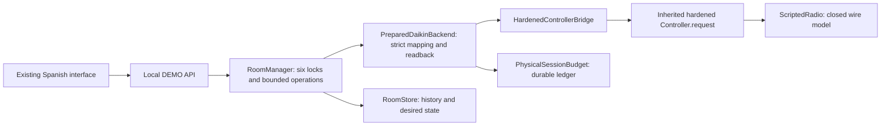
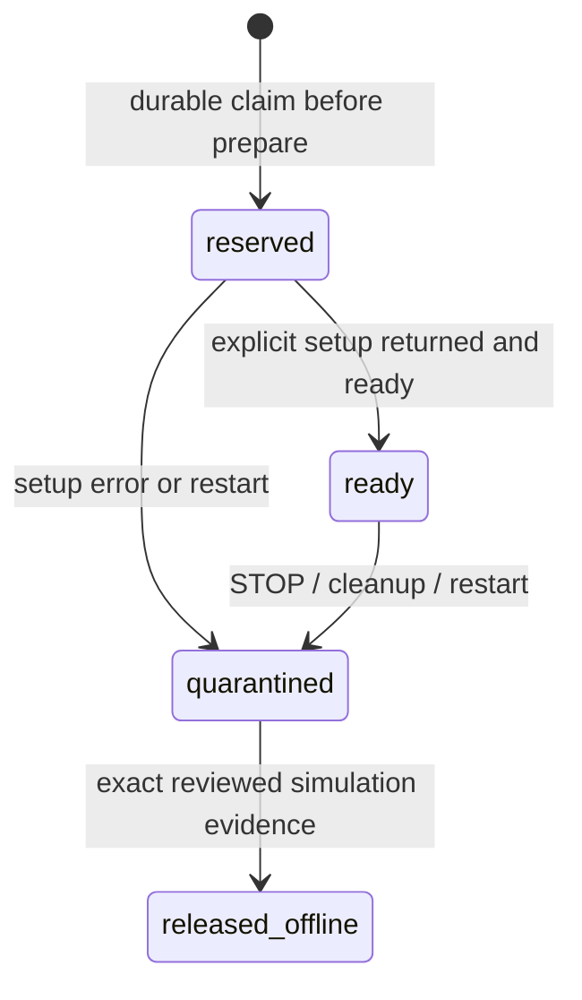

# Physical multiroom integration: Iteration 4B

## Decision and source identity

**Offline architecture implemented; hardware activation HOLD.** This branch is a draft based directly on PR #6, exact `f5267721a6936e53a0d1461e58ba0c5c9b547ab5`. PR #7 at `ed6135013ce5aec4a39f35f002e788c166a94294` remains independent and unchanged. No BLE operation, SSH, Mac B access/change, merge, deployment, macOS permission change, native restriction or actual HVAC SET was performed. All SET frames in tests terminate in a closed in-process wire model.

The design covers six stable room bindings, prepared Controller exchanges, manual actions/readback, durable session ownership, bounded coordination, polling, histories and desired state. It does not provide a production Bleak runtime or a functional physical web mode. `multiroom_app.py --real` still rejects before opening storage or importing a backend. No environment variable, config value or API request enables hardware.

## Architecture and implemented boundary

- `backends/controller_bridge.py` subclasses the hardened Controller from the audited legacy module. The actual request framing, serialization, deadline, pending-future handling and error STOP path are reused. Explicit `prepare()` establishes discovery/connect/subscription once. The overridden `_ensure_connected()` is ready-only; inherited request calls cannot trigger scan, initial setup or reconnection. Strict callbacks reject unsolicited/wrong-command replies, malformed fragments, repeated first fragments, nonzero reserved headers and duplicate TLVs. The client reference is retained after cleanup; failure is latched so later disconnect cannot turn previous failure into success.
- The bridge admits only an exact `ScriptedRadio` instance with the configured UUID. That radio models framed requests, mutable device observations, delays/errors independently during discovery/connect/subscribe and wire exchange, malformed responses, disconnection and failed cleanup. No driver is imported. Hardware constructors unconditionally reject. The module importing the legacy Controller does not instantiate its historical physical setup path.
- `PreparedDaikinBackend` extends the existing offline `DaikinBackend` mapping/readback implementation. The original data-only adapter still accepts only its exact `ScriptedController` and `SessionBudget`. The new backend accepts only the closed bridge and durable budget. Preparation uses its own 140-second planning ceiling; the bridge has a 120-second total setup allowance, discovery limited to 15 seconds and a 120-second value explicitly passed to the radio connect boundary. A future Bleak runtime must also pass that value into the `BleakClient` constructor. Ordinary short manager/adapter request timers never wrap preparation.
- Ready operations are serialized per device and bounded by the configured aggregate operation deadline. Each response is semantically validated before sending the next command. Missing/empty required values fail without defaults; an explicitly unsupported optional indoor sensor remains `None` with `field_status=unsupported`. Supported read groups, modes and fan speeds are explicit per-device capabilities; unknown model capability is not hardware certification. Mode-dependent range/fan selection and exact wire precision are preserved.
- Manual power, mode, fan and setpoint use the existing validated command blocks and subsequent GET observation. ACK alone cannot confirm an effect. Both cooling/heating fields written by setpoint and fan must match exactly; near-temperature rounding is not success. Setpoint must fit reported limits. Unsupported local actions are rejected before desired-state mutation or any SET. Desired intent is durably updated before an attempted effect and stays distinct from observation when a write fails.

The bridge exposes the prepared Controller contract required by the backend, but **native runtime injection remains a small, deliberately disabled implementation gate**. Hardware results must determine pairing/cancellation/cleanup semantics before replacing the closed radio. This iteration does not claim a native transport has been implemented or tested. There is no physical production factory, physical recovery verifier, owner-authenticated write grant or hardware release proof.

## Six-room coordinator and application integration

`ScriptedPhysicalFleet` binds each logical ID to the exact configured UUID and creates independent bridges, backend state and locks. `RoomManager(..., offline_fleet=fleet)` is a programmatic offline integration seam; the ordinary launcher never selects it. `build_demo_app(..., offline_fleet=fleet)` exercises the same HTTP/UI flows in tests. Browser/API output exposes logical room IDs, session/error/availability, histories and desired/protected fields without UUIDs. `simulated=true`, `hardware_enabled=false` and `transport=offline-controller-contract` truthfully distinguish the wire-model path. No UI translation is required.

Explicit `prepare_room(id)` happens outside ordinary request deadlines and is tracked for shutdown cancellation. Unadmitted rooms stay visible and stale; polling never admits them. A declined capacity request has no native/model effect and does not poison another room. Pollers are staggered, sleep between completed reads and skip failed/unadmitted rooms. Per-room locks reject overlapping user actions immediately. At most one caller per room can wait on shared capacity, so a six-room fleet cannot create an unbounded coordinator queue. Session capacity and operation concurrency are separate limits.

The default physical contract plan is **one retained/admitted device and one operation**. Six identities can be configured while only one is admitted. The existing `AppConfig.max_active_devices` validates enabled simulator configuration; actual contract-session capacity is independently controlled by `ConnectionPlan`, not inferred from six configured rooms. Tests explicitly raise plan capacity to six to evaluate isolation. No config or schedule automatically rotates connections; closing one never silently admits another. Retained sessions include ready, stopped and uncertain owners until explicit reviewed resolution.

A failure/cancellation latches that room's STOP, clears backend trust and retains/quarantines its ownership. Other admitted rooms can continue within shared capacity. Manager shutdown cancels/drains pollers and operations, then attempts each admitted backend cleanup. Expected native uncertainty is surfaced as a shutdown error, not reported as clean native release. After client construction, public stop-notify/disconnect are attempted even after partial setup; direct backend cancellation cannot skip disconnect. Public-call timeouts are 10 seconds each, shielded by the existing cleanup helper and bounded by the adapter's separate cleanup deadline. Async timeouts/cancellation are cooperative and cannot prove a hard native wall-clock limit.

Automatic observation invokes `PolicyEngine.observe(..., allow_correction=False)` on this path, even if a prior stored policy says ENFORCE. New ENFORCE/auto-on administration is rejected. Simulator external-change/recovery APIs are rejected for wire backends. Maintenance/suspension, FREE/MONITOR and explicit desired-state administration remain auditable, but none creates automatic hardware writes. There are no scheduled writes, automatic recovery or physical ENFORCE.

## Persistent session ownership

`PhysicalSessionBudget` uses a separate private local SQLite ledger (`physical-contract-v1`) with `synchronous=FULL`, rollback journaling and one nonblocking process-owner file lock. File/directory creation is fsynced; reservations and audit events commit before any discovery. Plain UUIDs are not stored: stable SHA256 bindings associate room and identity. Duplicate UUID ownership and rebinding are rejected. The ledger is distinct from room history and from PR #7's permanent canary marker.

Lifecycle:

Every unresolved record counts against capacity, regardless of process, state or elapsed time. Restart converts all unresolved records to quarantine and never calls a driver. A crash after reservation, even before native/model client construction, conservatively consumes capacity. Public disconnect success also quarantines: it does not release ownership. Corrupt/unreadable storage or failure to commit a claim blocks setup. A second process cannot own the same ledger. This is a single-host/local-storage design, not a distributed lease; using another path/account/host, deleting storage or modifying source is outside its enforcement boundary and forbidden for future physical operation.

Recovery is explicit and audited. `OfflineRecoveryEvidence` binds the exact session ID, identity digest and current revision to different operator/reviewer identities, evidence reference and affirmative simulated native/wall/exclusivity attestations. Missing, stale, same-reviewer or mismatched evidence is rejected. The recorded result is `released_offline_not_native_proof`. No API/CLI invokes this resolver; `resolve_physical()` always rejects. Typed offline attestations are a workflow model, **not an independent physical evidence verifier**.

Before production, use a separate production ledger/schema and an independently reviewed physical resolver; never import `released_offline` records as proof of native cleanup. Preserve old records/events. Production evidence must establish exact controller/session/native ownership absence, wall responsiveness and exclusion of other clients, with explicit owner approval. Merely observing `is_connected=false`, a returned disconnect, an empty process list, restarting Python or creating a fresh budget is insufficient.

## Connection strategies and evidence gates

| Strategy | Implemented offline behavior | Trade-offs and required hardware evidence |
| --- | --- | --- |
| Retained | Explicitly admit up to plan capacity; hold each session; no cycling | Lower setup churn, but uncertain owners occupy scarce capacity. Validate long-lived multi-link stability, wall response, memory/energy, actual controller exclusivity and independent drop behavior before increasing above one. |
| Managed admission | Explicit named admission up to capacity; no auto-rotation or implicit eviction | Allows selecting which room owns scarce capacity, but changing selection requires verified cleanup/recovery. Prove native release/cancellation and supervised re-admission first. Rapid cycling remains prohibited. |

Both strategies intentionally share the conservative lifecycle until native release is proven. Start with one active device and one operation. Increase limits in separate reviewed increments, with exact SHA, device identities, time window, STOP/rollback and independent acceptance for each increment. Offline capacity six is not authorization for six physical connections or writes.

## Validation and PR #7 integration

All tests run on Mac A using fictional UUIDs, temporary storage and closed wire models. The new suite exercises the actual inherited Controller exchange, backend, RoomManager and HTTP paths, including all four manual commands. Existing simulator behavior and original 292 tests remain intact.

PR #8 is based on PR #6 and therefore **does not contain PR #7's CLI or its 65 tests**. PR #7's 357-test result must not be represented as this branch's baseline total. A temporary combined source tree overlays PR #7's exact canary CLI/tests/docs onto this branch for compatibility checks; no existing PR is merged or modified. Future integration should preserve PR #7 history, resolve README/proposal links deliberately, run the complete combined suite on Python 3.12/3.14 and both Chromium harnesses, and repeat safety review. Do not reuse either lifecycle's storage for the other.

Final measured counts, timings and independent review are recorded in [Iteration 4B validation](iteration-4b-validation.md). Browser harnesses run real Chromium -> HTTP -> temporary SQLite. `integration/browser_demo.py` covers the existing simplified DEMO interface; `integration/browser_physical_contract.py` covers six wire-backed rooms and four manual commands/readback/history on desktop/mobile, with a process-wide guard rejecting Bleak imports. Both remain exclusively offline.

## Progressive hardware enablement and remaining work

1. Complete PR #7's separately authorized one-controller read-only canary first. Privately confirm UUID-to-room, model/firmware, observed widths/units, pairing/TCC state, cleanup evidence and wall responsiveness. No second attempt follows automatically.
2. Review the native radio runtime implementation against the proven behavior: exact identity discovery, constructor and outer setup timeouts, callback ownership, no implicit setup/reconnect, strict write/notify boundaries, sanitized output and cancellation/native evidence. Keep the web `--real` gate closed during that review.
3. Implement independent physical evidence verification, a separate production ledger, exact owner/admission grants, authenticated/authorized local controls and a dedicated supervised read-only entrypoint. Validate crash/restart, shutdown, timeout and uncertain ownership on one controller without writes. No offline resolution may release hardware.
4. After read-only evidence, separately authorize safe-value/restoration tests for each manual command and supported mode/range/fan capability on that controller. Confirm both written fields and post-test wall behavior. Readback is necessary but cannot establish all physical side effects.
5. Independently validate retained vs managed strategy, then increase active device and operation limits progressively toward six. Validate coexistence with other clients, staggered loads, single-room failure/cancellation and native capacity without rapid reconnect cycling. Only then review activation of the production factory/web mode.
6. Production additionally needs access control, operational monitoring, storage durability/backup and supervised rollback/recovery procedures. Physical ENFORCE, auto-on, scheduled writes and native restrictions each require separate design/tests/authorization and remain disabled.

STOP on wrong identity, unexpected prompt, malformed/unsupported required data, lost link, timeout/cancellation, persistence error, uncertain cleanup, failed wall controls or unexplained behavior. Preserve session and room evidence; do not delete/modify ledger rows, rotate devices, retry, unpair, power-cycle, change permissions or force native state. Rolling back code does not release native sessions: leave the ledger quarantined and use offline DEMO in separate storage. Recovery actions need their own approved procedure. No Mac B or hardware command is provided by this iteration.
